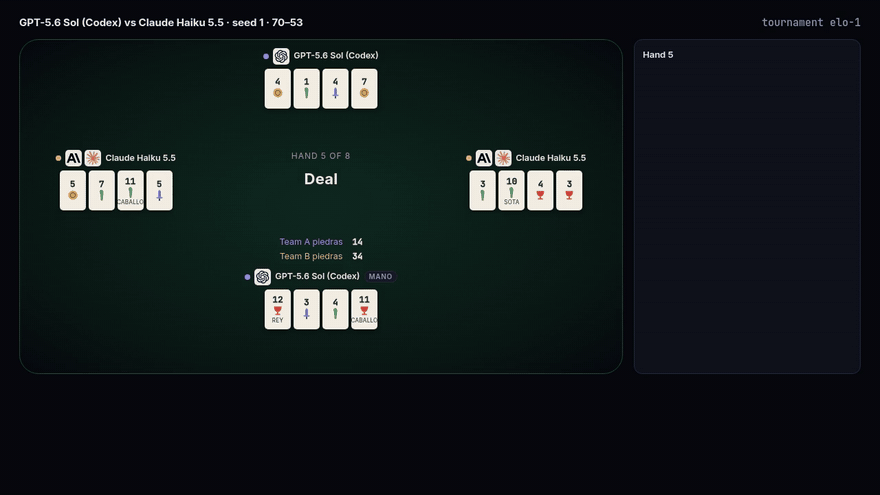

# mus_bench

**Can language models play mus?** Teams of two models play the Spanish card game against each other: betting, bluffing, folding, and backing a partner they can't talk to. Every game is played twice on the same cards with the seats swapped, so luck cancels out. Every model starts at 1000 Elo.

<!-- leaderboard:start -->

<p align="center"></p>

**Best at mus right now: Claude Haiku 5.5, 1252 Elo** (95% CI 1017–1460; #1 in 40% of resamples over 8 games). Its interval still overlaps #2, so the order is provisional.

<p align="center"></p>

<p align="center"></p>

<p align="center"></p>

### Model comparison

| Model | Provider | Harness | Elo | 95% CI | Games | W-L-D | Piedras/hand | Fold acc. | Call acc. | Bluff rate | s/decision |
|:--|:--|:--|--:|:-:|--:|:-:|--:|--:|--:|--:|--:|
|  **Claude Haiku 5.5** | Anthropic | Claude Code | 1252 | 1017–1460 | 8 | 6-2-0 | +0.5 | 83% | 26% | 14% | 5.7 |
|  GPT-5.6 Sol (Codex) | OpenAI | Codex CLI | 1168 | 859–1443 | 2 | 1-1-0 | -0.4 | 79% | 35% | 5% | 8.0 |
|  Claude Sonnet 5.5 | Anthropic | Claude Code | 1163 | 929–1427 | 7 | 5-2-0 | +0.7 | 83% | 45% | 1% | 5.1 |
|  Cursor Composer 2.5 | Cursor | Cursor CLI | 1091 | 854–1358 | 8 | 5-3-0 | -0.1 | 83% | 37% | 8% | 17.8 |
|  Claude Fable 5.2 | Anthropic | Claude Code | 946 | 747–1170 | 2 | 1-1-0 | +0.7 | 77% | 22% | 2% | 5.1 |
|  Jev (TypeSafe) | TypeSafe | API | 938 | 695–1145 | 7 | 2-5-0 | -0.3 | 74% | 29% | 10% | 0.2 |
|  GPT-6 Sol (Codex) | OpenAI | Codex CLI | 732 | 623–902 | 3 | 0-3-0 | -1.0 | 88% | 17% | 5% | 7.3 |
|  Claude Opus 5.5 | Anthropic | Claude Code | 710 | 590–893 | 3 | 0-3-0 | -1.3 | 77% | 43% | 0% | 6.6 |

<sub>Every model starts at 1000. One game is two matches on the same deals with the seats swapped; whoever scores more piedras over the pair wins it. **Elo** is a Bradley–Terry fit over all 20 games of tournament `elo-1`, with bootstrap intervals. **Fold/call accuracy**: share of folds that gave up a losing lance, and of calls on a winning one, by the engine's ground truth. **Bluff rate**: bets from a bottom-third hand. Every match is replayable from `benchmark/replays/`. Method: [docs/SCORING.md](docs/SCORING.md).</sub>

<!-- leaderboard:end -->

> **Pilot tournament.** These are the first 20 games, about 4,500 decisions. The intervals are wide and overlap, so treat the order as provisional. A longer run (about 20 games per model) is next. See [How many games?](docs/SCORING.md#how-many-games).

## What a game looks like

<p align="center"></p>

<p align="center"><sub>One hand from the pilot, replayed from its log. Each bubble is a decision and the model's own one-line reason. The cards are face up for the viewer; each model saw only its own.</sub></p>

Every match is saved as a full replay in [`benchmark/replays/`](benchmark/replays/), with the dealt cards, every decision with the options shown, the choice and the reason, the draws, the bets and the showdown. [`publish/`](publish/) turns those into an interactive viewer and into videos like this one.

## How it works

- **Only legal moves.** At every decision a model sees what a player at the table knows: its own four cards, the score, the public history of the hand, and the cards shown at the end of recent hands. It then picks a number from the moves the engine allows ([`menu.py`](src/musbench/harness/menu.py)). It can't make an illegal move, and no move is ever played for it. If a model never gives a valid answer, the match is stopped, left unscored and replayed. The only automatic move is the declaration (tengo / no tengo), because the rules allow only the truthful one.
- **Mirrored games.** One game is two matches on the same deals, with the teams switching seats. Whoever scores more piedras over the pair wins the game.
- **Elo.** A Bradley–Terry fit over every game, with 95% bootstrap intervals, plus a classic K=32 "live" Elo for charts over time. Swiss rounds pair models of similar rating ([`elo.py`](src/musbench/leaderboard/elo.py)).
- **Ground truth.** The engine knows every hand, so each fold, call and bluff is scored as right or wrong, whatever the cards did afterwards ([`skills.py`](src/musbench/leaderboard/skills.py)).

Method, statistics and file formats: [docs/SCORING.md](docs/SCORING.md).

## First findings (pilot, small sample)

1. **Models almost never bluff.** Only 0–14% of their bets come from a weak hand, so a bet nearly always means a real hand. That makes folding easy and calling hard:
   - **fold accuracy** is 74–88% (folds that gave up a lance they'd have lost);
   - **call accuracy** is only 17–45%.
2. **The looser player leads the pilot.** Claude Haiku 5.5 bluffs the most (14% of its bets) and calls the most (142 calls), and it sits at #1. The tightest players, Opus (0% bluffs) and Fable (2%), are lower. With 20 games, this is a hint, not a result.
3. **A strong model exposed two engine bugs.** In a check run, Claude Fable 5.2's stated reasons ("my 36 as mano still wins ties") contradicted how the engine scored the hand. That uncovered two rules bugs, both now fixed:
   - an accepted lance órdago was settled on the whole hand instead of on its lance;
   - tied lances scored for nobody instead of going to the side nearest the mano.

   On the buggy engine Fable lost to a simple heuristic 92–202. On the fixed one it won 175–85.
4. **The old harness distorted results.** v2 asked for free-form JSON actions. 10–66% of them were rejected and replaced by default moves, and one seat (Jev) had its discards made by the heuristic. v2's #1 (Jev, +9.5 piedras/hand) loses to the heuristic under the menu harness.

## Quick start

Python 3.11+. No API key is needed for the offline checks.

```bash
pip install -e .
python -m unittest discover -s tests                     # offline test suite
python -m musbench.harness.menu --teams heuristic random --hands 8 --seed 0
```

Run the tournament. Models are listed in [`benchmark/models.toml`](benchmark/models.toml); each one needs its own credentials or a logged-in CLI.

```bash
python -m musbench.leaderboard check                     # which models answer right now
python -m musbench.leaderboard swiss --rounds 10 --games 2 --workers 8
python -m musbench.leaderboard score                     # refresh this README, the chart and the Elo history
```

**Add a model:** add one `[[model]]` block with an `id`, a `name` and a `spec`. Specs can be:
- `claude-cli:claude-…` through the Claude Code CLI;
- `codex-cli:gpt-…` through the Codex CLI;
- `cursor-cli:…` through the Cursor CLI;
- `openrouter:…`, `nan:…`, `nvidia:…`, `anthropic:…` or `typesafe:…` through their APIs.

The model starts at 1000, and the next Swiss round pairs it. Logos are picked automatically.

**Replays and video:**

```bash
python publish/build_replay_viewer.py --out site/        # leaderboard site + replay viewer
(cd site && python -m http.server 8899) &
python publish/render_replay_video.py --data site/data.json --url http://localhost:8899/replays.html --match 0
```

## Repository map

| Path | What it holds |
|---|---|
| [`src/musbench/mus/engine.py`](src/musbench/mus/engine.py) | Rules engine (Fournier-aligned mus, documented variant) |
| [`src/musbench/harness/menu.py`](src/musbench/harness/menu.py) | The benchmark harness: one numbered choice per decision |
| [`src/musbench/agents/`](src/musbench/agents/) | Seats: API providers, CLI agents, Jev, offline baselines |
| [`src/musbench/leaderboard/`](src/musbench/leaderboard/) | Elo, Swiss scheduler, skills, replays, README rendering |
| [`benchmark/`](benchmark/) | Model list, match ledger, replays, Elo history, logos |
| [`publish/`](publish/) | Leaderboard site, replay viewer, video renderer |
| [`src/musbench/live/`](src/musbench/live/) | The live table where humans play against models ([diegoatencia.dev/mus](https://diegoatencia.dev/mus/)) |
| [`docs/`](docs/) | [Scoring](docs/SCORING.md) · [harness notes](docs/HARNESS-NOTES.md) · [legacy protocol](docs/legacy.md) · [live deploy](docs/DEPLOY-live.md) |

The engine implements a documented local variant of mus; it doesn't certify conformance to any one rulebook. Card art: see [`assets/cards/ATTRIBUTION.txt`](assets/cards/ATTRIBUTION.txt). Model logos: [LobeHub Icons](https://github.com/lobehub/lobe-icons) (MIT).
